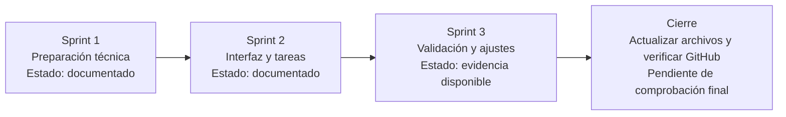
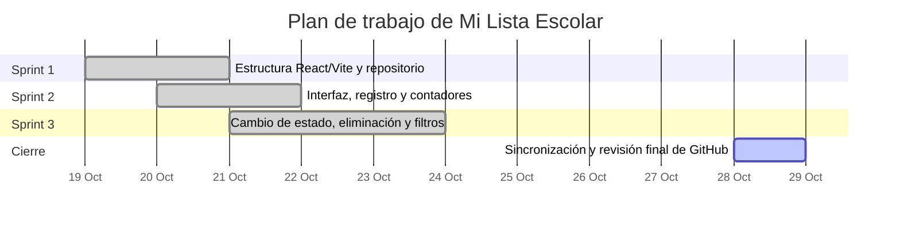

# Mi Lista Escolar — Reporte final de Sprints, backlog y Sprint Schedule

**Estudiante:** Orlando Padilla Vilches  
**Programa:** Licenciatura en Desarrollo de Sistemas Web  
**Proyecto:** Mi Lista Escolar  
**Tecnologías:** React, JavaScript, CSS, Vite y GitHub  
**Entrega:** Proyecto final, Unidad 3  
**Asesora:** Monsserat Granillo Garrido

## 1. Descripción y objetivo

Mi Lista Escolar es una aplicación web para organizar actividades académicas. Permite registrar tareas, asignarles una materia o categoría, marcar actividades como completadas o pendientes, eliminarlas y filtrarlas por estado.

El objetivo de este reporte es documentar las fases de trabajo, los resultados observados, las pruebas realizadas y los pendientes de validación. Los estados se basan en las evidencias descritas en la Actividad 3; no se declara como completada una prueba que no tenga respaldo suficiente.

## 2. Fases de los Sprints

| Sprint | Objetivo y actividades | Resultado documentado | Estado |
|---|---|---|---|
| Sprint 1. Preparación técnica | Preparar la estructura React/Vite, organizar archivos y publicar el proyecto en GitHub. | La aplicación se ejecutó localmente y el repositorio contiene los archivos principales. La compilación de producción se reportó ejecutada sin errores. | Completado según la evidencia disponible; revisar que GitHub corresponda a la versión final. |
| Sprint 2. Interfaz y gestión de tareas | Construir la interfaz principal, registrar tareas y mostrar contadores de total, pendientes y completadas. | Las capturas muestran la interfaz, las tareas y los contadores. | Implementación documentada. |
| Sprint 3. Validación y ajustes finales | Probar el cambio de estado, la eliminación, los filtros y la coherencia de los contadores; actualizar documentación. | Se documentaron capturas del cambio de estado, la eliminación y los filtros Pendientes y Completadas. La validación específica de título vacío y accesibilidad no se considera cerrada. | Funciones principales documentadas; quedan verificaciones puntuales. |

## 3. Gráfica de los Sprints

El siguiente esquema muestra la secuencia y el estado general de las fases. Es una representación del avance documentado, no una medición porcentual ni un registro automático de GitHub.

### Estado de tareas por fase

**Nota:** las fechas del gráfico son una referencia visual de planificación para organizar las fases y no deben interpretarse como marcas de tiempo verificadas de cada tarea.

## 4. Backlog actualizado

| ID | Elemento del backlog | Prioridad | Criterio de aceptación | Estado |
|---|---|---|---|---|
| PB-01 | Estructura React/Vite | Alta | La aplicación inicia en el entorno local. | Documentado como ejecutado. |
| PB-02 | Interfaz principal | Alta | Se muestran encabezado, resumen, formulario y lista. | Observado en capturas. |
| PB-03 | Agregar tareas | Alta | Una tarea válida aparece en la lista y cambian los contadores. | Función implementada; repetir prueba y conservar captura actual. |
| PB-04 | Cambiar estado | Alta | El checkbox cambia el estado y los contadores reflejan el cambio. | Cambio documentado mediante captura. |
| PB-05 | Eliminar tareas | Alta | La tarea desaparece y el total se actualiza. | Eliminación documentada mediante captura. |
| PB-06 | Filtrar por estado | Alta | Los filtros muestran todas, solo pendientes o solo completadas, según corresponda. | Filtros documentados mediante capturas. |
| PB-07 | Validar título vacío | Media | No se acepta una tarea sin título y se informa al usuario. | Pendiente de prueba específica. |
| PB-08 | Mensajes y accesibilidad | Media | Las acciones informan el resultado y los controles tienen etiquetas comprensibles. | Hay mensajes y etiquetas en el código; falta una prueba específica de accesibilidad. |
| PB-09 | Sincronización con GitHub | Alta | Los archivos publicados corresponden al código y reporte final. | Verificar tras sustituir este documento y revisar los archivos de código. |

## 5. Sprint Schedule actualizado

Los días se presentan como secuencia de trabajo; no representan horas reales ni fechas históricas verificadas.

| Día / fase | Actividad | Entregable o evidencia | Estado |
|---|---|---|---|
| Sprint 1 · Preparación | Organizar React/Vite y repositorio. | Archivos principales y aplicación ejecutándose. | Documentado. |
| Sprint 2 · Construcción | Implementar interfaz, registro y contadores. | Capturas de interfaz y tareas. | Documentado. |
| Sprint 3 · Día 1 | Probar cambio entre pendiente y completada; revisar contadores. | Captura del cambio de estado. | Documentado. |
| Sprint 3 · Día 2 | Probar eliminación de una tarea. | Captura posterior a la eliminación. | Documentado. |
| Sprint 3 · Día 3 | Probar filtros Pendientes y Completadas. | Captura de cada filtro. | Documentado. |
| Cierre · Revisión | Probar título vacío, revisar accesibilidad y sincronizar archivos. | Registro de pruebas y repositorio final. | Pendiente de comprobación final. |

## 6. Registro de pruebas y evidencias

| Prueba | Resultado documentado | Evidencia / limitación |
|---|---|---|
| Cambiar tarea a completada | Se observó el cambio de estado y el mensaje de confirmación. | Captura de la aplicación. |
| Volver tarea a pendiente | Se observó el cambio de estado. | Captura de la aplicación. |
| Eliminar una tarea | Se observó la eliminación y la reducción del total. | Captura posterior a la eliminación. |
| Filtrar pendientes | Se mostró la tarea pendiente correspondiente. | Captura del filtro Pendientes. |
| Filtrar completadas | Se mostró la tarea completada correspondiente. | Captura del filtro Completadas. |
| Agregar una tarea nueva | La función está implementada. | Repetir la prueba en la versión que se entregará y conservar captura actual. |
| Intentar agregar título vacío | La validación aparece en el código según la documentación previa. | Prueba específica pendiente. |
| Compilación de producción | Se reportó `npm run build` sin errores en la documentación previa. | Ejecutar de nuevo si se modifica el código; el resultado debe corresponder a la versión publicada. |

Las capturas deben incorporarse al reporte final como evidencia visual. No se sustituyen por una descripción textual: deben mostrar la aplicación funcionando.

## 7. Responsabilidades

Este repositorio documenta el proyecto individual **Mi Lista Escolar**. Por ello, la responsabilidad de implementación, pruebas, actualización del backlog, documentación y publicación se asigna al estudiante indicado en la portada. No se atribuyen tareas a compañeros sin información confirmada.

| Responsabilidad | Responsable | Entregable |
|---|---|---|
| Estructura y código de la aplicación | Orlando Padilla Vilches | Proyecto React/Vite en GitHub |
| Interfaz, tareas y contadores | Orlando Padilla Vilches | Funcionalidades de la aplicación |
| Pruebas manuales y capturas | Orlando Padilla Vilches | Evidencias de funcionamiento |
| Backlog, Sprint Schedule y reporte | Orlando Padilla Vilches | Documentación final |
| Revisión de sincronización del repositorio | Orlando Padilla Vilches | Archivos publicados coherentes con el reporte |

## 8. Repositorio de GitHub

Código fuente: https://github.com/orlandopadilla4543-sketch/mi-lista-escolar

La carpeta `docs` debe contener este archivo actualizado. Antes de entregar, revisar que `src`, `package.json`, `index.html` y el resto de archivos del proyecto sean los que corresponden a la versión probada. No declarar sincronización final hasta comprobarlo.

## 9. Conclusión

Los avances documentados muestran la estructura de la aplicación, su interfaz y las funciones de cambio de estado, eliminación y filtrado de tareas. El cierre requiere mantener el backlog y el Sprint Schedule alineados con las pruebas, incorporar las capturas al reporte y comprobar que el código publicado en GitHub corresponde con la versión evaluada. Las validaciones que aún no cuentan con evidencia deben mantenerse como pendientes.

## 10. Referencias

Schwaber, K., & Sutherland, J. (2020). *The Scrum Guide: The definitive guide to Scrum: The rules of the game*. https://scrumguides.org/scrum-guide.html

GitHub. (s. f.). *About repositories*. GitHub Docs. https://docs.github.com/en/repositories/creating-and-managing-repositories/about-repositories

React. (s. f.). *Quick start*. https://react.dev/learn
